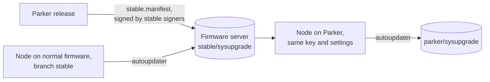

# Release Parker to nodes on the normal firmware

This document is for release managers. Nodes change from the normal
FFMUC firmware to Parker automatically. Users do not do a step. Nodes
do not need config mode.

## How it works

1. The Parker build makes a manifest for each branch: `parker`,
   `experimental`, `testing` and `stable` (see `make manifest`).
2. The release managers publish the Parker images and, for example, the
   Parker `stable.manifest` in the `stable` directory of the firmware
   server. The signers of `stable` sign this manifest.
3. A node on the normal firmware uses its current branch and its current
   signers. It finds a newer version and installs Parker.
4. On the first boot, Parker keeps the settings of the node:

   | Setting | Result |
   | --- | --- |
   | Hostname, location, contact, SSH keys, password | Kept by sysupgrade. |
   | Mesh VPN on or off, bandwidth limit, wired mesh | Kept by Gluon. |
   | Domain (for example `ffmuc_muc_cty`) | Each old domain code is an alias of a Parker domain. |
   | WireGuard key | `ff-mesh-vpn-parker-migrate` moves it to Parker. The broker sees the same public key. |
   | Autoupdater branch | Set to `parker` by `update_channel` in `site.conf`. |

## Rules for a release

- **Version:** the Parker release tag must be higher than the version on
  the nodes. The autoupdater does not install a lower version.
- **Signatures:** each manifest needs the signatures that its branch
  requires: `experimental` 2, `testing` 2, `stable` 3.
- **Steps:** publish to `experimental` first, then `testing`, then
  `stable`. Each step is a group of nodes.
- **Spread:** set `GLUON_PRIORITY` (in days) when you make the manifest.
  Then the nodes of a branch do not all update on the same day. Example:
  `make manifest GLUON_PRIORITY=7`.
- **Devices:** a device without a Parker image stays on the normal
  firmware.

## Go back

Publish a normal firmware with a higher version in the `parker`
manifest. The nodes install it. The migration package keeps
`/etc/config/wireguard`, so the normal firmware uses the same key again.
