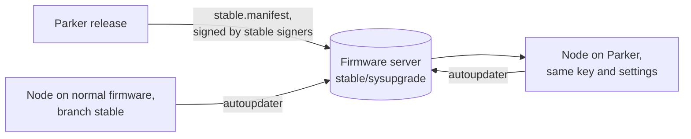
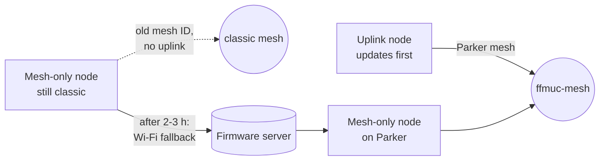

# Release Parker to nodes on the normal firmware

This document is for release managers. Nodes change from the normal
FFMUC firmware to Parker automatically. Users do not do a step. Nodes
do not need config mode.

This branch is parker-next (Gluon v2026.1.x). It uses the normal
autoupdater branches. A parker-next node does not install a parker
(Gluon v2025.1) image.

## How it works

1. The Parker build makes a manifest for each branch: `experimental`,
   `testing` and `stable` (see `make manifest`). Parker uses the same
   branches, mirrors and signers as the normal firmware. The `parker_next`
   manifest is for the transition only (see below).
2. The release managers publish the Parker images and, for example, the
   Parker `stable.manifest` in the `stable` directory of the firmware
   server. The signers of `stable` sign this manifest.
3. A node on the normal firmware uses its current branch and its current
   signers. It finds a newer version and installs Parker.
4. On the first boot, Parker keeps the settings of the node:

   | Setting | Result |
   | --- | --- |
   | Hostname, location, contact, SSH keys, password | Kept by sysupgrade. |
   | Mesh VPN on or off, bandwidth limit, wired mesh | Kept by Gluon. |
   | Domain (for example `ffmuc_muc_cty`) | Each old domain code is an alias of a Parker domain. |
   | WireGuard key | `ff-mesh-vpn-parker-migrate` moves it to Parker. The broker sees the same public key. |
   | Autoupdater branch | Kept. A node on `stable` stays on `stable`. |

## Nodes on the old `parker_next` branch

Earlier parker-next releases set each node to the `parker_next` branch.
This branch is not in `site.conf` now.

- A node on `parker_next` gets the next release from the `parker_next`
  manifest in `parker-next/sysupgrade`. Its old firmware has this branch.
  Gluon allows only letters, digits and `_` in a branch name.
- After the upgrade, `update_channel` in `site.conf` sets the node to
  `experimental`.
- Remove `parker_next` from `make manifest` when no node uses it.

## One mesh for all domains

All Parker domains (`ffmuc`, `ffdon`, `ffwert`, `ffdlg_dlg`,
`ffbachtal_bachtal`) use the same mesh ID (`ffmuc-mesh`) and the same
`domain_seed`. The seed sets the VXLAN ID of the wired mesh. Thus the domain
selects only the Wi-Fi name (SSID). Nodes in different domains mesh with each
other over Wi-Fi and over cable.

- Parker gives each node its own prefixes. The domains have no prefixes, no
  mesh VPN settings and no own DNS servers.
- `ffdon` uses 2.4 GHz channel 1. On 2.4 GHz, `ffdon` nodes do not mesh with
  nodes on channel 6. On 5 GHz and over cable they mesh.
- The old domain codes stay valid, for example `ffmuc_dlg` for Dillingen.

### Selector in the config mode

The selector is labelled "Wi-Fi name (SSID)". It shows each SSID once.

- In each domain file, all names in `domain_names` are the SSID.
- `hide_domain` hides all codes except the main code of the file.
- A node that uses a hidden code keeps it. The selector shows the SSID of
  that code once, with the code of the node as the default. The patch
  `1013-gluon-config-mode-domain-select-show-each-name-once.patch` removes
  the second entry with the same name.
- To add an SSID, add a domain file. Do not add a second visible code with
  the same SSID.

## Mesh during the change

A classic node and a Parker node do not mesh: the mesh IDs are different.
Each node changes its mesh when it installs Parker.

- A mesh-only node loses its uplink when its uplink node updates first.
- `ffac-autoupdater-wifi-fallback` repairs this after 2 to 3 hours. The node
  must receive an open Wi-Fi name that contains `freifunk`.
- A mesh-only node that has only a cable link (for example behind an
  offloader) cannot use the Wi-Fi fallback. Update it manually, or update it
  before its uplink node.
- On 2026-11-19 the map showed 118 mesh-only nodes with Wi-Fi only, 69 with
  cable only and 56 with both.

## Rules for a release

- **Version:** the Parker release tag must be higher than the version on
  the nodes. The autoupdater does not install a lower version.
- **Same branches:** Parker nodes and normal nodes use the same branches.
  A Parker node installs each higher version in its branch, also a normal
  firmware. For example, `v2026.11.3` is higher than
  `v2026.11.2-parker-next3`. The firmware server must give parker-next
  nodes the parker-next manifest.
- **Signatures:** each manifest needs the signatures that its branch
  requires: `experimental` 2, `testing` 2, `stable` 3.
- **Steps:** publish to `experimental` first, then `testing`, then
  `stable`. Each step is a group of nodes.
- **Spread:** set `GLUON_PRIORITY` (in days) when you make the manifest.
  Then the nodes of a branch do not all update on the same day. Example:
  `make manifest GLUON_PRIORITY=7`.
- **Devices:** a device without a Parker image stays on the normal
  firmware.

## Go back

Publish a normal firmware with a higher version in the manifest of the
branch. The nodes install it. The migration package keeps
`/etc/config/wireguard`, so the normal firmware uses the same key again.
